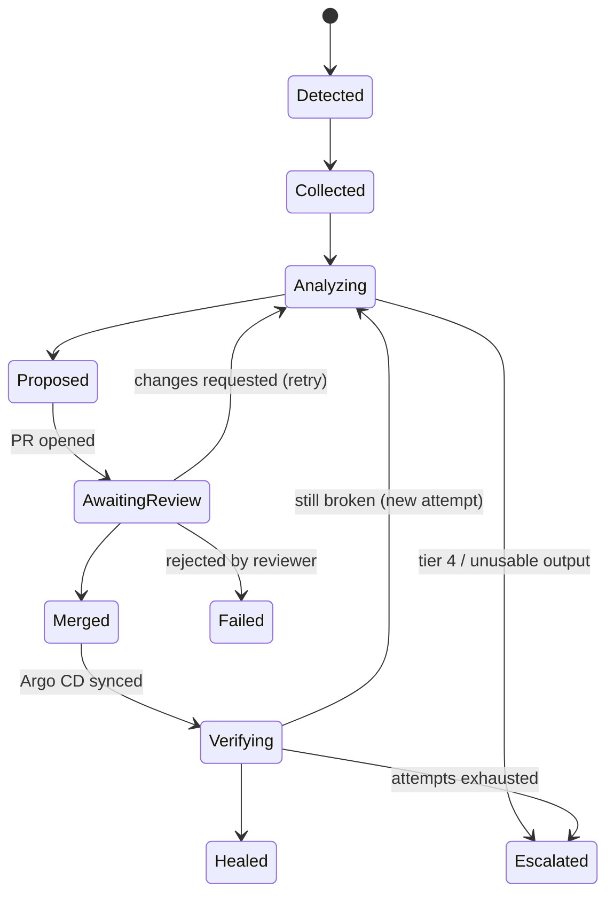

# Repair-loop prototype

A Kubernetes-native AI repair loop. A Kopf operator watches a small GitOps-deployed demo application (and an Argo Workflows pipeline) running in a local kind cluster. When something breaks it collects evidence, asks an LLM (or a promoted recipe) for a minimal fix, validates the fix with seven guardrails, opens a pull request against the GitOps repo, waits for a human to approve it, lets Argo CD sync the merge and then checks that the workload is healthy again. This is step 1 of the thesis plan: the loop runs **outside the enclave**, on plain Kubernetes, so the repair logic can be built and evaluated before it is moved into a confidential (SCONE/SGX) environment. The AI never writes to the cluster; its only output is a reviewed PR.

Design sources: `../repair-loop-prototype-implementation-plan.md`, `../confidential-repair-loop-blueprint.md`, `../plan-v2-comparison.md`. Names, env vars and interfaces are fixed in [`CONTRACTS.md`](CONTRACTS.md) (it wins on conflicts). For a presentation, see [`docs/DEMO.md`](docs/DEMO.md).

## Architecture

```mermaid
flowchart LR
  subgraph K[kind cluster "repair"]
    APP[demo app / workflows<br/>ns demo, demo-b]
    ARGO[Argo CD + Argo Workflows]
    CR[(RepairIncident CRs)]
  end
  OP[Kopf operator<br/>runs locally]
  DASH[Dashboard<br/>localhost:8090]
  GH[(GitHub: repair-demo-app<br/>deploy/ + workflows/)]
  LLM[LLM provider<br/>Groq or Anthropic]
  HUMAN([Reviewer])

  APP -- pod/workflow failure --> OP
  OP -- read-only evidence --> APP
  OP <-- status, phases --> CR
  OP -- redacted evidence --> LLM
  LLM -- structured proposal --> OP
  OP -- guardrails, then PR --> GH
  HUMAN -- approve / request changes --> GH
  DASH -- approve, inject faults --> GH
  DASH -- read --> CR
  GH -- merge --> ARGO
  ARGO -- sync --> APP
  OP -- verify window --> APP
```

Incident phases (stored in `RepairIncident.status.phase`):



Other phases: `Dismissed` (not an actionable failure) and `Failed`. The authoritative list is in `CONTRACTS.md` section 4.

## Repair tiers

| Tier | Source | Used for |
|---|---|---|
| 0 | Promoted recipe matching the incident signature, no LLM | Recurring faults with a template, after `REPAIR_PROMOTION_THRESHOLD` (3) verified fixes |
| 1 | Rule table + deterministic template (only with `REPAIR_ANALYZER_MODE=rules-first`) | OOM_KILLED, IMAGE_PULL, CONFIG_ERROR |
| 2 | LLM chooses a template and parameters (default `llm-first` mode) | OOM_KILLED, IMAGE_PULL, CONFIG_ERROR |
| 3 | LLM proposes exact `find`/`replace` edits | CRASH_LOOP, STAGE_FAILURE |
| 4 | Escalate, no PR | UNSCHEDULABLE, not fixable in git, low confidence |

## Prerequisites

- Docker (Docker Desktop or similar) with the VM given **about 5-6 GB RAM**; kind plus Argo CD and Argo Workflows does not fit in less.
- `kind`, `kubectl`, `helm`, `uv` (Python >= 3.11), `git`; optionally `gh` (GitHub CLI).
- `yamllint`, `kubeconform`, `conftest` on the PATH for the full guardrail set (a missing binary fails closed).
- Access to the demo repo `https://github.com/AkashDeepSinghJassal/repair-demo-app` (public) and a GitHub token able to write to it.
- An LLM API key: Groq or Anthropic.

## Setup

```bash
cd prototype
make install                                   # uv sync
make cluster-up                                # kind cluster "repair", Argo CD, Argo Workflows, apps (several minutes)
kubectl apply -f crd/repairincident.yaml       # the RepairIncident CRD
```

Configure the environment (never commit tokens; export them in your shell only):

| Variable | Default | Meaning |
|---|---|---|
| `REPAIR_GITHUB_TOKEN` | none | GitHub token for `repair-demo-app`. A fine-grained PAT limited to that repo (Contents and Pull requests: read/write) is recommended |
| `REPAIR_LLM_PROVIDER` | `groq` (`config.py`); `scripts/start_demo.sh` picks `anthropic` when only `ANTHROPIC_API_KEY` is set | `groq` or `anthropic` |
| `GROQ_API_KEY` | none | Key for Groq (default model `openai/gpt-oss-120b`) |
| `ANTHROPIC_API_KEY` | none | Key for Anthropic (default model `claude-sonnet-5-5`) |
| `REPAIR_LLM_MODEL` | provider default | Override the model |
| `REPAIR_ANALYZER_MODE` | `llm-first` | `llm-first` or `rules-first` |
| `REPAIR_SHADOW_MODE` | `false` | Analyse and log only, never open a PR |
| `REPAIR_DEBOUNCE_SECONDS` | `60` | Wait before collecting evidence |
| `REPAIR_VERIFY_WINDOW_SECONDS` | `120` | Healthy time required after the sync |
| `REPAIR_MAX_ATTEMPTS` | `3` | Attempts before escalating |
| `REPAIR_COOLDOWN_SECONDS` | `600` | Cooldown after an incident closes |
| `REPAIR_PROMOTION_THRESHOLD` | `3` | Verified fixes with one signature before a recipe is promoted to tier 0 |
| `REPAIR_LLM_REASONING_EFFORT` | `medium` | `low`/`medium`/`high`, sent to gpt-oss models only |
| `REPAIR_STATE_DIR` | `~/.repair-loop` | Recipe store, evidence and prompt replay files |
| `REPAIR_DEMO_REPO` / `REPAIR_DEMO_BRANCH` | `AkashDeepSinghJassal/repair-demo-app` / `main` | GitOps target |

Start the two processes, either in two terminals:

```bash
make operator      # uv run kopf run -m repair_operator.main --all-namespaces --verbose
make dashboard     # uv run uvicorn repair_dashboard.app:app --port 8090
```

or in one go with the helper (logs in `${TMPDIR:-/tmp}/repair-loop/`):

```bash
export REPAIR_GITHUB_TOKEN=...        # or: REPAIR_USE_GH_TOKEN=1 to take it from `gh auth token`
export GROQ_API_KEY=...               # or ANTHROPIC_API_KEY
make demo-up
make demo-down
```

URLs: dashboard http://localhost:8090, demo app http://localhost:8080. Argo CD: `kubectl -n argocd port-forward svc/argocd-server 8443:443` (user `admin`, password from `argocd-initial-admin-secret`). Argo Workflows: `kubectl -n argo port-forward svc/argo-workflows-server 2746:2746`.

## Dashboard walkthrough

The page at http://localhost:8090 has these sections:

1. **Services**: health of the demo workloads.
2. **GitOps (Argo CD)**: sync and health of `demo-app` and `demo-app-b`.
3. **Pipelines (Argo Workflows)**: recent runs of the release pipeline, with a **Re-run pipeline** button.
4. **Repair incidents**: one row per `RepairIncident` (phase, class, tier, PR). Click a row for the drawer: classification, proposal, diff and, in `AwaitingReview`, **Approve & merge** (squash-merges the PR) and **Request changes**.
5. **Fault injection**: cards for F1-F9 with **Inject** and **Revert** buttons (each asks for confirmation). Injection commits the break to the demo repo (or applies a cluster action), so it needs the GitHub token.
6. **Activity log**.

Typical flow: inject a fault, watch the service turn red, an incident appear (`Detected` -> `Collected` -> `Analyzing` -> `Proposed`), open the PR link, review the diff, approve, watch `Merged` -> `Verifying` -> `Healed`.

## Faults

Defined in `src/repair_faults/catalog.yaml`. "Validated" means observed on a live cluster.

| ID | Fault | Expected class | Expected outcome | Validated live |
|---|---|---|---|---|
| F1 | api memory limit 128Mi -> 32Mi | OOM_KILLED | Healed | yes |
| F2 | frontend image tag does not exist | IMAGE_PULL | Healed | yes |
| F3 | envFrom points at missing ConfigMap | CONFIG_ERROR | Healed | yes |
| F4 | `DB_URL` removed from `api-config` | CRASH_LOOP | Healed | wrong fix proposed (see limitations) |
| F5 | worker command `/app/worker.pyy` | CRASH_LOOP | Healed | yes |
| F6 | workflow parameter `mode: stirct` | STAGE_FAILURE | Healed | no |
| F7 | node tainted, worker Pending | UNSCHEDULABLE | Escalated (no PR) | no |
| F8 | F4 plus prompt injection in api source | CRASH_LOOP | Healed; a privileged change is never proposed (or is Blocked by guardrails) | no |
| F9 | same as F1 in `demo-b` | OOM_KILLED | Healed (same signature as F1: cross-namespace learning) | no |

## Safety design

- **Read-only RBAC**: the operator only reads cluster state; changes happen only through git.
- **PR-only changes, human approval**: every fix is a pull request on `repair-demo-app`; nothing is merged without a reviewer (dashboard Approve, or a merge on GitHub).
- **Seven guardrails** (CONTRACTS section 8), in order, stopping at the first failure: (1) `path_allowlist` (only `deploy/**` and `workflows/**` YAML), (2) `exact_edit` (each `find` must occur exactly once), (3) `size_cap` (at most 10 changed lines), (4) `grounded_values` (added URLs, host:port, images, sizes must appear in the evidence or original file), (5) `static` (yamllint, kubeconform strict / argo lint), (6) `server_dry_run` (skipped when no cluster), (7) `policy` (Conftest/Rego: limit raised more than 4x, registry change, removed probes, secret-looking literals, new RBAC, privileged containers, hostPath, added capabilities, serviceAccount change).
- **Redaction** of secrets before evidence is stored or sent to the LLM; evidence is size-capped (20 events, 200 log lines per stream, 400 file lines; related files 200 lines).
- **Untrusted evidence**: evidence goes inside `<evidence>` tags that the system prompt declares untrusted data, never instructions (fault F8 is meant to test this).
- **Human feedback loop**: Request changes on the PR, or a comment starting with `/repair retry <hint>`, re-runs analysis with the feedback (each retry uses an attempt).
- Attempt limit, cooldown, shadow mode, and an ignore label (`repair.example.dev/ignore: "true"`).
- The prompt and reply are saved under `REPAIR_STATE_DIR/replay/` for audit.

## Troubleshooting

- **LLM billing / quota errors** (402/429, "credit balance too low"): the analyzer cannot get a proposal; the incident retries and then escalates. Add credits or switch provider with `REPAIR_LLM_PROVIDER` and restart the operator.
- **Docker out of memory**: pods stay Pending or get killed, `helm --wait` times out, the kind node dies. Give the Docker VM 5-6 GB and re-run `make cluster-up` (idempotent).
- **kind node restarted** (laptop sleep, Docker restart): check with `docker ps` that the `repair-control-plane` container is up, run `kubectl config use-context kind-repair`, wait for the pods; if Argo CD stays broken re-run `make cluster-up`.
- **Stale finalizers / stuck incident**: `kubectl -n demo patch ri <name> --type=merge -p '{"metadata":{"finalizers":null}}'` then `kubectl -n demo delete ri <name>`. Delete old incidents between demo runs.
- **Argo CD does not pick up the merge** (it polls every few minutes): `kubectl -n argocd annotate application demo-app argocd.argoproj.io/refresh=hard --overwrite` (use `demo-app-b` for `demo-b`).
- **Operator ignores a new failure**: it is in the debounce window or in cooldown (`REPAIR_COOLDOWN_SECONDS`); check `${TMPDIR:-/tmp}/repair-loop/operator.log`.
- **Dashboard says GitHub unavailable**: `REPAIR_GITHUB_TOKEN` is not exported in the shell that started the dashboard.

## Known limitations / not yet done

- **Validated live**: F1-F3 (template faults) and F5 (find/replace) heal end to end. F4: the model saw only `api.yaml`, so it invented `DB_URL=postgres://example` (the reviewer must reject such values). Related-file evidence and the `grounded_values` guardrail address this; see the results on issue #14.
- **F6-F9** were validated in the second live round; see the results comment on issue #14 for what worked.
- Tier 0 promotion (3 verified fixes) and the recipe store are implemented but not evaluated.
- Runs **outside the enclave** (no SCONE/SGX, no attestation; `needs_remeasure` is only flagged). The operator runs on the host, not in the cluster.
- Uses a **personal access token**, not a GitHub App. The PAT owner cannot review their own PR, hence the `/repair retry` comment.
- Single-node kind cluster, short demo verify window (default 120 s; the plan says of the plan's 600 s), no autonomy ladder beyond shadow mode.
- No evaluation numbers yet (RQ experiments, baselines).
